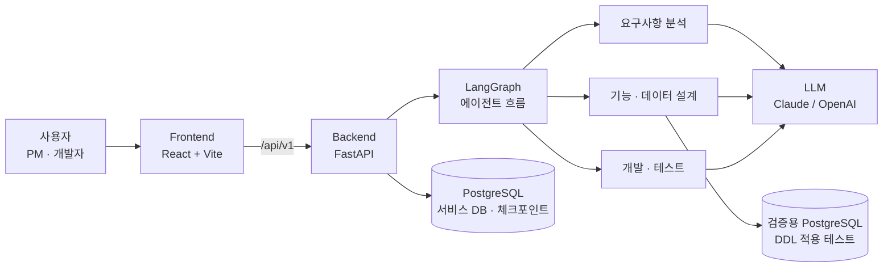

# ADAM — 요구사항 문서에서 실행되는 시스템까지

> 고객 요구사항 문서(RFP)를 올리면, AI 에이전트들이 요구사항 분석 → 설계 → 개발 → 테스트까지 이어서 수행하는 개발 자동화 서비스

요구사항 문서만 있으면 결과물은 누구나 만들 수 있습니다.
ADAM은 요구사항이 바뀌어도 바뀐 부분만 다시 설계하고 다시 개발하며, 모든 산출물이 원문의 어느 요구사항에서 나왔는지 추적할 수 있습니다.

<br>

## 주요 기능

| 단계 | 하는 일 |
| --- | --- |
| **문서 분석** | PDF · DOCX · HWPX 파싱 (LLM 없이 코드 규칙), 모든 블록에 원문 위치(쪽·제목 경로) 부여 |
| **요구사항 분석** | 요구사항 추출 · 검토, 근거를 못 찾은 항목은 '확인 필요'로 표시 |
| **설계** | 기능 명세 → 데이터 모델(ERD) → DDL → API 설계, DDL은 실제 PostgreSQL에 적용해 검증 |
| **개발 · 테스트** | 백엔드 · 프론트 코드 생성 → 실행 · 자동 확인 → 문제를 작업으로 배정 → 수정 → 검토 · 합치기 |
| **변경 대응** | 요구사항이 바뀌면 영향받는 부분만 다시 설계 · 개발 (버전 트리로 관리) |
| **협업** | PM · 개발자 역할별 권한, 승인 요청, Slack 알림 |

<br>

## 아키텍처



- 각 에이전트는 정해진 JSON 스키마(Pydantic)로만 응답하고, 인용한 근거는 원문과 글자 단위로 대조해 검증합니다.
- 단계 상태는 LangGraph 체크포인트로 저장되어 중간에 멈췄다가 이어서 하거나 바뀐 부분만 다시 실행할 수 있습니다.

<br>

## 기술 스택

| 영역 | 기술 |
| --- | --- |
| Backend | Python 3.12, FastAPI, LangGraph, Pydantic, SQLAlchemy, Alembic |
| LLM | Anthropic Claude, OpenAI (설정으로 전환, 프롬프트 캐싱 · 단계별 effort 조절) |
| Document | pdfplumber, pypdf, python-docx, lxml (HWPX) |
| Frontend | React 19, TypeScript, Vite 7, Tailwind CSS v4 |
| Database | PostgreSQL 16 |
| Infra | Docker Compose, AWS EC2 |
| 생성 코드 템플릿 | FastAPI / NestJS (백엔드), React + Vite / Next.js (프론트) |

<br>

## 폴더 구조

```
.
├─ backend/     FastAPI 서버 · LangGraph 에이전트 · 문서 파서 · 코드 생성   → backend/README.md
├─ frontend/    작업실 화면 (기능 명세 · ERD · 최종 산출물 · 개발)          → frontend/README.md
├─ docs/        기획 · 설계 문서
├─ compose.yaml PostgreSQL + API 실행
└─ Dockerfile
```

<br>

## 실행하기

```bash
# 1) 설정
cp .env.example .env              # ANTHROPIC_API_KEY 또는 OPENAI_API_KEY 입력

# 2) 백엔드
docker compose up -d db
python3.12 -m venv .venv && source .venv/bin/activate
pip install -r backend/requirements.txt
cd backend && alembic upgrade head
uvicorn app.main:app --reload     # http://127.0.0.1:8000/docs

# 3) 프론트 (다른 터미널)
cd frontend && npm install && npm run dev   # http://localhost:5173
```

시연할 때는 `.env`에 `LLM_MODE=replay`를 두면 녹화해 둔 LLM 응답(`backend/mock_data/llm_mock`)으로 재생되어 같은 요청은 API를 호출하지 않습니다.

자세한 내용은 [backend/README.md](backend/README.md), [frontend/README.md](frontend/README.md)를 참고하세요.

<br>

## 팀

TEAM4 팀 프로젝트로 개발했습니다.
